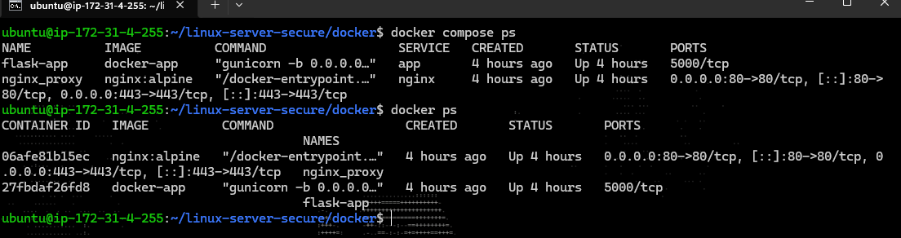
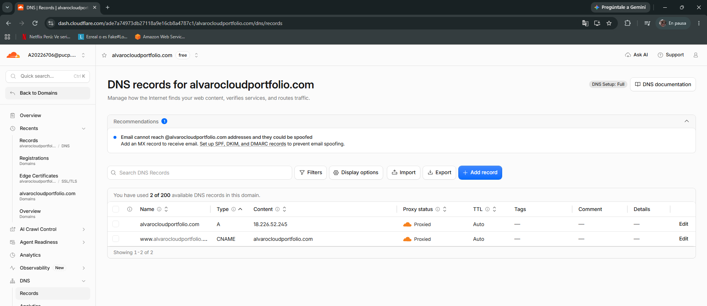
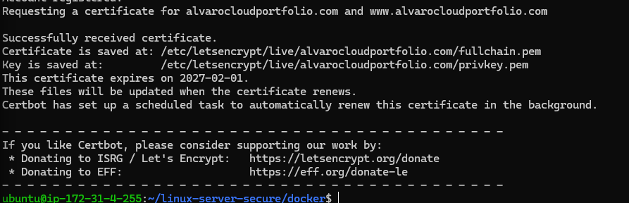
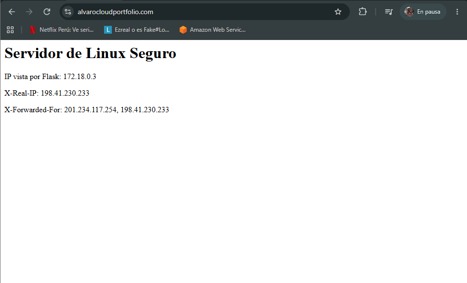

# Servidor Linux Seguro

Proyecto personal orientado a practicar administración de servidores Linux, seguridad básica, despliegue web y fundamentos de DevOps.

El laboratorio fue implementado sobre Ubuntu Server en VirtualBox y evolucionó desde una configuración tradicional con SSH, UFW, Nginx, Flask, Gunicorn y systemd hacia una arquitectura contenerizada utilizando Docker y Docker Compose.

## Tecnologías utilizadas

- Ubuntu Server
- Oracle VirtualBox
- OpenSSH
- UFW
- Nginx
- Python
- Flask
- Gunicorn
- systemd
- Docker
- Docker Compose
- Git y GitHub

## Arquitectura inicial

```text
Windows Host
    |
    | HTTP -> 127.0.0.1:8080
    v
VirtualBox NAT
    |
    v
Ubuntu Server
    |
    +-- Nginx :80
          |
          v
      Gunicorn :5000
          |
          v
        Flask
```

En esta primera etapa Nginx, Gunicorn y Flask eran ejecutados directamente sobre Ubuntu Server.

## Arquitectura contenerizada

Posteriormente la aplicación fue migrada a una arquitectura multi-contenedor:

```text
Windows
   |
   | 127.0.0.1:8080
   v
VirtualBox NAT
   |
   v
Ubuntu Server :80
   |
   v
Docker Compose
   |
   +-- Contenedor Nginx :80
   |        |
   |        | Reverse Proxy
   |        v
   +-- Contenedor Flask/Gunicorn :5000
```

Docker Compose crea además una red interna que permite la comunicación entre ambos servicios.

## Dockerización de Flask

Se creó una imagen propia para la aplicación Flask utilizando el siguiente `Dockerfile`:

```dockerfile
FROM python:3.12-slim

WORKDIR /app

COPY requirements.txt .

RUN pip install --no-cache-dir -r requirements.txt

COPY app.py .

CMD ["gunicorn", "-b", "0.0.0.0:5000", "app:app"]
```

Las dependencias utilizadas fueron:

```text
Flask
gunicorn
```

La imagen puede construirse mediante:

```bash
docker build -t flask-seguro .
```

## Nginx en Docker

Nginx fue ejecutado en un contenedor independiente y configurado como reverse proxy.

Configuración principal:

```nginx
server {
    listen 80;
    server_name _;

    location / {
        proxy_pass http://flask-app:5000;

        proxy_set_header Host $host;
        proxy_set_header X-Real-IP $remote_addr;
        proxy_set_header X-Forwarded-For $proxy_add_x_forwarded_for;
        proxy_set_header X-Forwarded-Proto $scheme;
    }
}
```

A diferencia de la arquitectura inicial, Nginx ya no utiliza:

```text
127.0.0.1:5000
```

para localizar Flask.

Ahora utiliza:

```text
flask-app:5000
```

porque ambos servicios se encuentran dentro de una red Docker y pueden comunicarse utilizando el nombre del contenedor.

## Docker Compose

Se utilizó Docker Compose para administrar ambos servicios desde un único archivo:

```yaml
services:

  app:
    build: .
    container_name: flask-app
    expose:
      - "5000"
    restart: unless-stopped

  nginx:
    image: nginx:alpine
    container_name: nginx_proxy
    ports:
      - "80:80"
    volumes:
      - ./nginx/default.conf:/etc/nginx/conf.d/default.conf:ro
    depends_on:
      - app
    restart: unless-stopped
```

La aplicación completa puede iniciarse mediante:

```bash
docker compose up -d
```

Verificar los servicios:

```bash
docker compose ps
```

Detener y eliminar los contenedores:

```bash
docker compose down
```

Y volver a desplegar todo:

```bash
docker compose up -d
```

## Comunicación entre contenedores

La comunicación interna sigue este flujo:

```text
Cliente
   ↓
Nginx
   ↓
flask-app:5000
   ↓
Gunicorn
   ↓
Flask
```

Nginx utiliza la red interna de Docker para encontrar el contenedor `flask-app`.

Esto permite que el puerto `5000` no tenga que estar publicado directamente hacia el host.

## Headers del reverse proxy

La aplicación Flask permite comprobar qué dirección observa directamente y qué información recibió desde Nginx.

Ejemplo obtenido:

```text
IP vista por Flask: 172.18.0.3
X-Real-IP: 172.18.0.1
X-Forwarded-For: 172.18.0.1
```

Esto demuestra que la petición pasa primero por Nginx antes de llegar al contenedor Flask.

## Comandos útiles

Ver contenedores:

```bash
docker ps
```

Ver imágenes:

```bash
docker images
```

Ver los servicios de Compose:

```bash
docker compose ps
```

Ver logs:

```bash
docker compose logs
```

Logs específicos de Nginx:

```bash
docker logs nginx_proxy
```

Logs de Flask/Gunicorn:

```bash
docker logs flask-app
```

## Resultado final

El proyecto evolucionó desde una instalación tradicional:

```text
Ubuntu
→ Nginx
→ Gunicorn
→ Flask
```

hacia una arquitectura contenerizada:

```text
Ubuntu
→ Docker Compose
   ├── Nginx
   └── Flask + Gunicorn
```

Con esta segunda arquitectura se consiguió:

- aislar las dependencias de la aplicación;
- crear un entorno reproducible;
- separar Nginx y Flask en diferentes contenedores;
- implementar comunicación mediante una red interna de Docker;
- gestionar múltiples servicios mediante Docker Compose;
- mantener Nginx como único punto de entrada hacia la aplicación.

## Despliegue en AWS EC2

Después de probar la aplicación localmente con Docker Compose, se realizó el despliegue en una instancia Ubuntu Server 24.04 LTS en AWS EC2.

En la instancia se instalaron Git, Docker y Docker Compose. Luego se clonó el repositorio y se levantaron los contenedores con:

```bash
git clone https://github.com/a20226706-cyber/linux-server-secure.git
cd linux-server-secure/docker

docker compose up -d
docker compose ps
```

La aplicación utiliza dos contenedores:

- `nginx_proxy`: recibe las solicitudes HTTP y HTTPS.
- `flask-app`: ejecuta la aplicación Flask mediante Gunicorn.

Flask no se encuentra expuesto directamente a Internet. La comunicación entre Nginx y Flask se realiza mediante la red interna creada por Docker Compose.

```text
Internet
   |
   v
AWS EC2
   |
   v
Docker Compose
   |
   +-- nginx_proxy :80 / :443
   |        |
   |        v
   +-- flask-app :5000
```

### Security Group

En AWS se configuraron las siguientes reglas de entrada:

| Servicio | Puerto | Origen |
|---|---:|---|
| SSH | 22 | IP pública del administrador |
| HTTP | 80 | 0.0.0.0/0 |
| HTTPS | 443 | 0.0.0.0/0 |

El acceso por SSH se mantiene limitado a una IP específica, mientras que los puertos 80 y 443 son públicos para permitir el acceso a la aplicación.

La clave privada `.pem` utilizada para conectarse a la instancia no se almacena en el repositorio.

---

## Dominio y DNS

Para acceder al servidor mediante un nombre de dominio se utilizó:

```text
alvarocloudportfolio.com
```

El dominio se administra mediante Cloudflare.

Se configuraron los siguientes registros DNS:

```text
A
alvarocloudportfolio.com
-> IPv4 pública de la instancia EC2

CNAME
www.alvarocloudportfolio.com
-> alvarocloudportfolio.com
```

Con el proxy de Cloudflare habilitado, el tráfico web pasa primero por Cloudflare y luego es enviado al servidor de origen en AWS.

```text
Usuario
   |
   v
Cloudflare
   |
   v
AWS EC2
```

La instancia EC2 utiliza una IPv4 pública dinámica. Si la instancia se detiene y se vuelve a iniciar, la dirección puede cambiar y es necesario actualizar el registro `A` en Cloudflare.

---

## Configuración de HTTPS

Para habilitar HTTPS en el servidor se utilizó Certbot con Let's Encrypt.

Primero se instaló Certbot:

```bash
sudo apt update
sudo apt install certbot -y
```

Como el puerto 80 estaba siendo utilizado por el contenedor Nginx, los contenedores se detuvieron temporalmente:

```bash
docker compose down
```

Luego se solicitó el certificado para el dominio principal y para `www`:

```bash
sudo certbot certonly --standalone \
  -d alvarocloudportfolio.com \
  -d www.alvarocloudportfolio.com
```

Los certificados quedaron almacenados en:

```text
/etc/letsencrypt/live/alvarocloudportfolio.com/fullchain.pem
/etc/letsencrypt/live/alvarocloudportfolio.com/privkey.pem
```

`fullchain.pem` contiene el certificado y su cadena de confianza.

`privkey.pem` contiene la clave privada y no debe publicarse ni incluirse en GitHub.

---

## HTTPS en Nginx

Para que el contenedor Nginx pueda utilizar los certificados, se agregó el puerto 443 y se montó el directorio de Let's Encrypt en modo solo lectura.

Fragmento del archivo `compose.yml`:

```yaml
ports:
  - "80:80"
  - "443:443"

volumes:
  - ./nginx/default.conf:/etc/nginx/conf.d/default.conf:ro
  - /etc/letsencrypt:/etc/letsencrypt:ro
```

También se modificó la configuración de Nginx para redirigir las solicitudes HTTP hacia HTTPS:

```nginx
server {
    listen 80;
    server_name alvarocloudportfolio.com www.alvarocloudportfolio.com;

    return 301 https://$host$request_uri;
}
```

La configuración del servidor HTTPS utiliza los certificados generados por Certbot:

```nginx
server {
    listen 443 ssl;
    server_name alvarocloudportfolio.com www.alvarocloudportfolio.com;

    ssl_certificate /etc/letsencrypt/live/alvarocloudportfolio.com/fullchain.pem;
    ssl_certificate_key /etc/letsencrypt/live/alvarocloudportfolio.com/privkey.pem;

    location / {
        proxy_pass http://flask-app:5000;

        proxy_set_header Host $host;
        proxy_set_header X-Real-IP $remote_addr;
        proxy_set_header X-Forwarded-For $proxy_add_x_forwarded_for;
        proxy_set_header X-Forwarded-Proto $scheme;
    }
}
```

Después de realizar los cambios se volvieron a iniciar los contenedores:

```bash
docker compose up -d
docker compose ps
```

---

## Cloudflare y Full (strict)

Una vez configurado HTTPS en Nginx, Cloudflare se configuró en modo:

```text
SSL/TLS -> Full (strict)
```

De esta manera, el tráfico se cifra tanto entre el navegador y Cloudflare como entre Cloudflare y el servidor EC2.

```text
Navegador
   |
   | HTTPS
   v
Cloudflare
   |
   | HTTPS
   v
AWS EC2
   |
   v
Nginx
   |
   v
Flask / Gunicorn
```

Cloudflare valida el certificado de Let's Encrypt instalado en el servidor antes de establecer la conexión con el origen.

---

## Arquitectura final

```text
Usuario
   |
   | HTTPS :443
   v
Cloudflare
   |
   | HTTPS :443
   v
AWS Security Group
   |
   v
EC2 Ubuntu Server
   |
   v
Docker Compose
   |
   +-- Nginx :80 / :443
   |       |
   |       v
   +-- Flask + Gunicorn :5000
```

La aplicación queda disponible mediante:

```text
https://alvarocloudportfolio.com
```

Con esta etapa, el proyecto pasó de ejecutarse únicamente en una máquina virtual local a estar desplegado en una instancia pública de AWS, utilizando Docker Compose, Nginx, DNS y HTTPS.

## Evidencias

### Contenedores ejecutándose en AWS



### Configuración DNS en Cloudflare



### Certificado generado con Certbot



### Aplicación publicada mediante HTTPS

